# NARDOL Technical Reference

## 1. Purpose and Scope
NARDOL ("Light the beacons, see who answers") is a lightweight, cross-platform Java 21 CLI and TUI reachability probe. It measures Layer-4 and Layer-7 connectivity, latency, jitter, loss, and fiber-optic physical efficiency from the user's host to physically distributed, region-pinned unicast servers worldwide.

For high-level user orientation, quick start, and command cookbook, consult the [README](README.md). This document provides architectural diagrams, class mappings, concurrency design, protocol parsing, and extension instructions for engineers maintaining or extending the codebase.

---

## 2. Developer Quick Start
- **Toolchain**: Java 21 LTS (Oracle GraalVM / Amazon Corretto / Eclipse Temurin).
- **Build**: `./gradlew build`
- **Run without install**: `./gradlew run --args="run --region Europe"`
- **Test**: `./gradlew test` (fully offline, no external networks)
- **Check Size Budget**: `./gradlew jarSizeCheck` (enforces `< 10 MB` hard limit, target `< 6 MB`; fat jar compiles to ~1.56 MB).
- **Run Single Test**: `./gradlew test --tests com.explodenot.nardol.probe.ProbeTest`
- **Verify Legacy Tokens**: `./gradlew verifyNoLegacyNames`

---

## 3. System Context

The following diagram illustrates how Nardol interacts with user input, local storage, remote verification mirrors, and global endpoints.

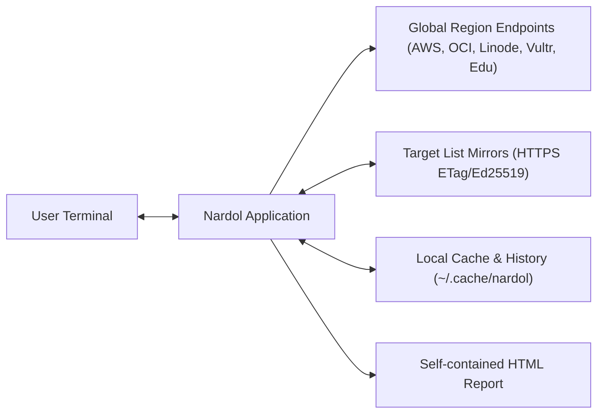

---

## 4. Architecture Overview

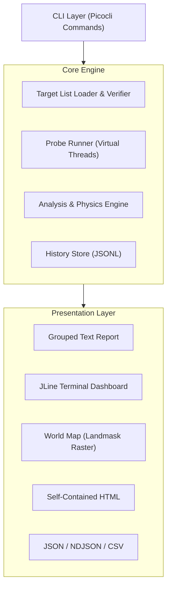

---

## 5. Package Dependency Map

The project enforces strict separation of concerns:
- `model` is completely independent and contains zero internal imports.
- `render` formats presentation data but never invokes `probe` or initiates sockets.
- `probe` executes network checks and produces typed outcomes.
- `analysis` processes pure numbers (stats, Haversine, physics limits) without I/O.
- These constraints are validated in `ArchitectureRulesTest`.

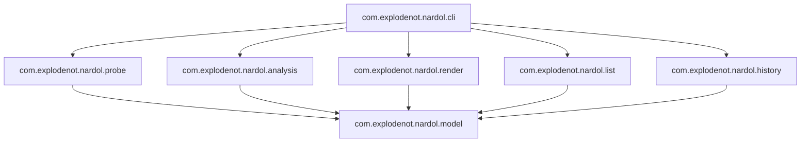

---

## 6. Repository Map

```text
gli/
├── src/main/java/com/explodenot/nardol/
│   ├── Main.java
│   ├── analysis/
│   │   ├── Baseline.java
│   │   ├── CorrelationDetector.java
│   │   ├── Efficiency.java
│   │   ├── Geo.java
│   │   └── Stats.java
│   ├── cli/
│   │   ├── CompletionCommand.java
│   │   ├── ConfigCommand.java
│   │   ├── ConfigFile.java
│   │   ├── DoctorCommand.java
│   │   ├── ExitCodes.java
│   │   ├── HistoryCommand.java
│   │   ├── ListCommand.java
│   │   ├── NardolCommand.java
│   │   └── VersionProvider.java
│   ├── history/
│   │   └── HistoryStore.java
│   ├── list/
│   │   ├── JsonListParser.java
│   │   ├── ListCache.java
│   │   ├── RemoteFetcher.java
│   │   ├── SignatureVerifier.java
│   │   ├── TargetListLoader.java
│   │   ├── TargetValidator.java
│   │   └── TsvParser.java
│   ├── model/
│   │   ├── AddressFamily.java
│   │   ├── ProbeMode.java
│   │   ├── ProbeOutcome.java
│   │   ├── ProbeSample.java
│   │   ├── Region.java
│   │   ├── RegionGroup.java
│   │   ├── RegionResult.java
│   │   ├── RunReport.java
│   │   ├── Target.java
│   │   └── Tier.java
│   ├── probe/
│   │   ├── ControlChecks.java
│   │   ├── FailureClassifier.java
│   │   ├── HttpProber.java
│   │   ├── ProbeRunner.java
│   │   ├── Prober.java
│   │   ├── TcpProber.java
│   │   └── TlsProber.java
│   ├── render/
│   │   ├── Ansi.java
│   │   ├── ColorDepth.java
│   │   ├── CsvOut.java
│   │   ├── Glyphs.java
│   │   ├── HtmlReport.java
│   │   ├── JsonOut.java
│   │   ├── ProgressLine.java
│   │   ├── ReportRenderer.java
│   │   ├── Rgb.java
│   │   ├── Sparkline.java
│   │   ├── TerminalHelper.java
│   │   ├── TextWidth.java
│   │   ├── TuiApp.java
│   │   └── WorldMap.java
│   └── util/
│       ├── Platform.java
│       └── TimeProvider.java
```

| Class | Package | Responsibility | Primary Collaborators | Test Class |
|---|---|---|---|---|
| `Main` | root | Entry point, CLI dispatcher, error trapping | `NardolCommand` | `CliTest` |
| `Baseline` | analysis | Historical comparison & baseline median deltas | `Stats` | `AnalysisTest` |
| `CorrelationDetector`| analysis | Detects shared continental degradation | `RegionResult` | `AnalysisTest` |
| `Efficiency` | analysis | Haversine distance, speed-of-light fiber floor | `Geo`, `Stats` | `AnalysisTest` |
| `Geo` | analysis | Great circle haversine mathematics | None | `AnalysisTest` |
| `Stats` | analysis | Median, percentiles, stddev jitter, loss % | None | `AnalysisTest` |
| `NardolCommand` | cli | Root command & subcommands coordination | `ProbeRunner`, `TargetListLoader` | `CliTest` |
| `CompletionCommand` | cli | Shell autocompletion script generator | `NardolCommand` | `CliTest` |
| `ConfigCommand` | cli | Config get/set/reset subcommands | `ConfigFile` | `ConfigAndHistoryTest` |
| `ConfigFile` | cli | JSON user preferences configuration | Gson | `ConfigAndHistoryTest` |
| `DoctorCommand` | cli | Environment diagnostics and pre-flight checks | `ControlChecks`, `TerminalHelper` | `CliTest` |
| `ExitCodes` | cli | Posix/BSD compliant process exit constants | None | `CliTest` |
| `HistoryCommand` | cli | History CLI query and CSV/JSON export | `HistoryStore` | `ConfigAndHistoryTest` |
| `ListCommand` | cli | Target list inspection, updating and linting | `TargetListLoader`, `TargetValidator`| `CliTest` |
| `VersionProvider` | cli | Dynamic version resolution from properties | Properties | `CliTest` |
| `HistoryStore` | history | JSON Lines history read/write and rotation | `RunReport`, Gson | `ProbeTest` |
| `JsonListParser` | list | JSON format target list parser | `TargetValidator`, Gson | `ListTest` |
| `ListCache` | list | Target list filesystem cache & ETag handling | `Platform` | `ListExtendedTest` |
| `RemoteFetcher` | list | HTTP client for remote list downloads | HttpClient | `RemoteFetcherTest` |
| `SignatureVerifier` | list | Ed25519 and SHA-256 integrity verifier | KeyFactory, Signature | `ListTest` |
| `TargetListLoader` | list | Network -> Cache -> Bundled list fallback | `RemoteFetcher`, `ListCache` | `ListExtendedTest` |
| `TargetValidator` | list | Strict regex/boundary data validation | `Tier` | `ListExtendedTest` |
| `TsvParser` | list | Canonical tab-separated list parser | `TargetValidator` | `ListTest` |
| `AddressFamily` | model | IPv4, IPv6, AUTO enumeration | None | `ProbeTest` |
| `ProbeMode` | model | TCP, TLS, HTTP enumeration | None | `CliTest` |
| `ProbeOutcome` | model | Sealed interface for Success and Failures | None | `ProbeTest` |
| `ProbeSample` | model | Individual sample measurement record | `ProbeOutcome` | `ProbeTest` |
| `Region` | model | Immutable geographic region descriptor | None | `ListTest` |
| `RegionGroup` | model | Primary + Fallback candidate cluster | `Target`, `Region` | `ListTest` |
| `RegionResult` | model | Aggregated probe result for a region | `Stats`, `Efficiency` | `AnalysisTest` |
| `RunReport` | model | Overall probe execution report | `RegionResult` | `CliTest` |
| `Target` | model | Specific server host endpoint record | `Tier` | `ListTest` |
| `Tier` | model | PRIMARY or FALLBACK enum | None | `ListTest` |
| `ControlChecks` | probe | Pre-flight DNS (Cloudflare, Google, Quad9, Umbrella), raw IP, and proxy checks | Socket | `FailureClassifierTest`|
| `FailureClassifier`| probe | Maps JDK network exceptions to sealed types & filters bogon/private IPs | `ProbeOutcome` | `FailureClassifierTest`|
| `HttpProber` | probe | HTTP HEAD & Range GET prober | HttpClient | `ProbeTest` |
| `ProbeRunner` | probe | Virtual thread executor and concurrency gate | `Prober`, Semaphore | `ProbeTest` |
| `Prober` | probe | Interface for protocol probe executors | `Target`, `ProbeOutcome` | `ProbeTest` |
| `TcpProber` | probe | Timed DNS resolution and TCP socket connect | Socket | `ProbeTest` |
| `TlsProber` | probe | TLS handshake and SNI cipher measurement | SSLSocket | `ProbersExtendedTest` |
| `Ansi` | render | ANSI escape sequence colorizer | `ColorDepth`, `Rgb` | `RenderTest` |
| `ColorDepth` | render | NONE, ANSI16, ANSI256, TRUECOLOR detector | None | `RenderTest` |
| `CsvOut` | render | Comma-separated output renderer | `RunReport` | `CliTest` |
| `Glyphs` | render | Unicode vs ASCII symbol provider | None | `RenderTest` |
| `HtmlReport` | render | Self-contained single-file HTML generator | SVG, JSON | `CliTest` |
| `JsonOut` | render | Formatted and newline-delimited JSON output | Gson | `CliTest` |
| `ProgressLine` | render | Live interactive terminal progress indicator | Virtual Thread | `RenderTest` |
| `ReportRenderer` | render | Grouped terminal report with gradient bars | `Ansi`, `Glyphs` | `RenderTest` |
| `Rgb` | render | 24-bit color representation and gradients | None | `RenderTest` |
| `Sparkline` | render | Unicode/ASCII sparkline generator | `Glyphs` | `RenderTest` |
| `TerminalHelper` | render | JLine terminal initialization and fallbacks | TerminalBuilder | `CliTest` |
| `TextWidth` | render | Display column width counter (wide chars) | CodePoint | `RenderTest` |
| `TuiApp` | render | Alternate-screen full interactive TUI | JLine Terminal | `RenderTest` |
| `WorldMap` | render | Equirectangular terminal map rasterizer | Landmask | `RenderTest` |
| `Platform` | util | OS directories and path detection | None | `PlatformTest` |
| `TimeProvider` | util | Clock and nanoTime abstraction | Instant | `PlatformTest` |

---

## 7. Command and Data Flow for `nardol run`

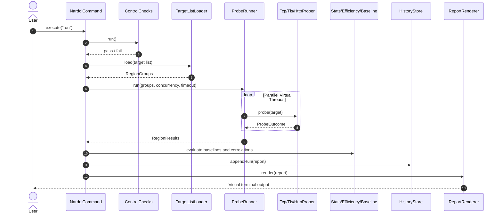

---

## 8. Target List Loading & Verification

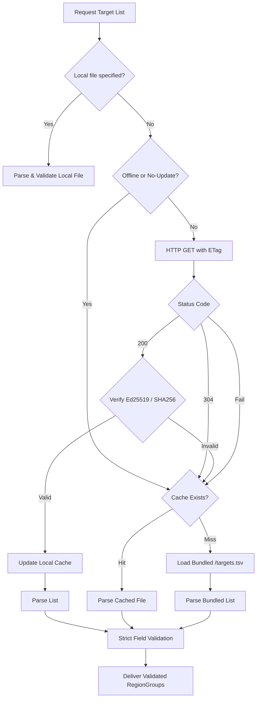

---

## 9. Fallback-Group Probing Logic

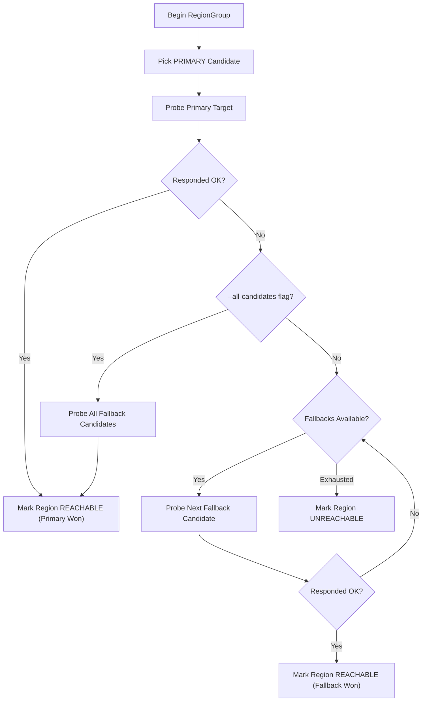

---

## 10. Probe Pipeline and Failure Classification

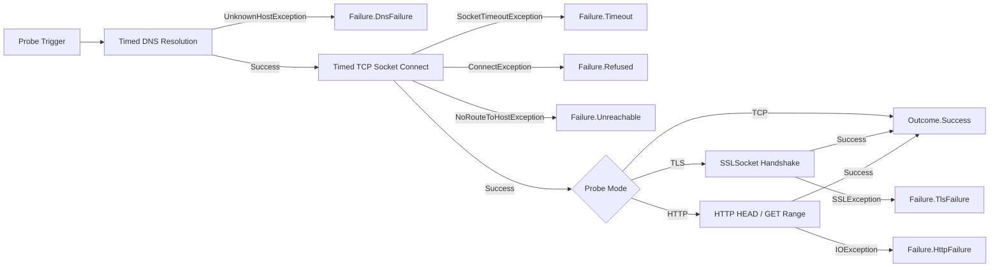

---

## 11. Concurrency Model

```mermaid
flowchart LR
    Start["ProbeRunner.run()"] --> VT["Virtual Thread Executor"]
    VT --> SemGlobal["Global Semaphore (cap=64)"]
    SemGlobal --> SemHost["Per-Domain Host Semaphore (cap=2)"]
    SemHost --> Probe["Execute Probe with Timeout"]
    Probe --> ReleaseHost["Release Host Semaphore"]
    ReleaseHost --> ReleaseGlobal["Release Global Semaphore"]
    ReleaseGlobal --> Collector["Thread-Safe Results Collection"]
```

---

## 12. Domain Model

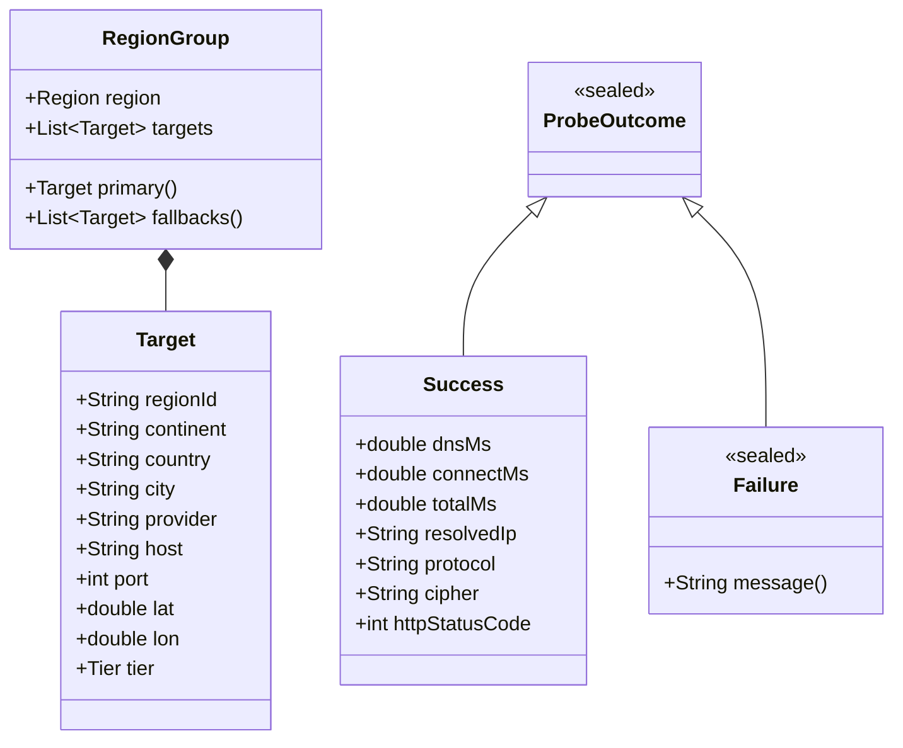

---

## 13. Analysis Engine

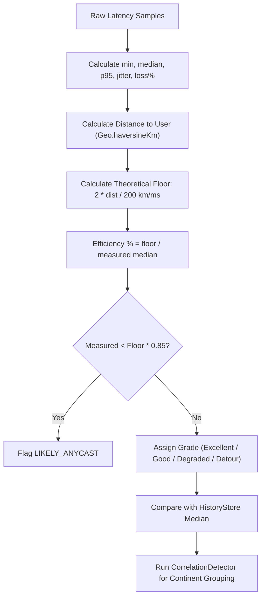

---

## 14. Data Formats

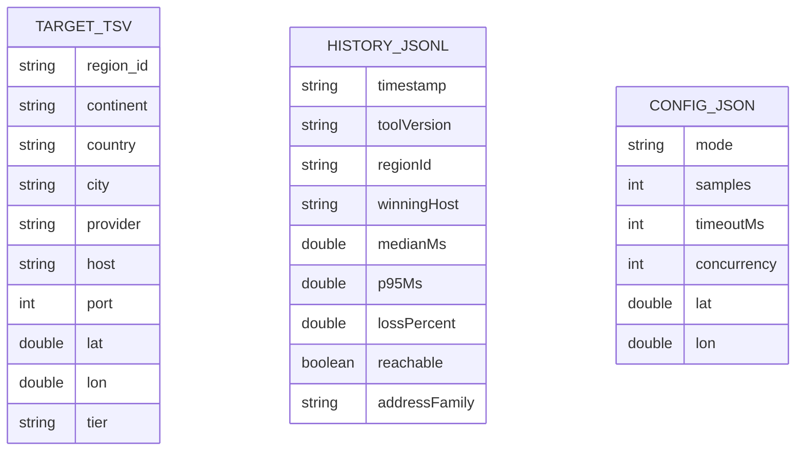

---

## 15. Rendering Pipeline & Graceful Degradation

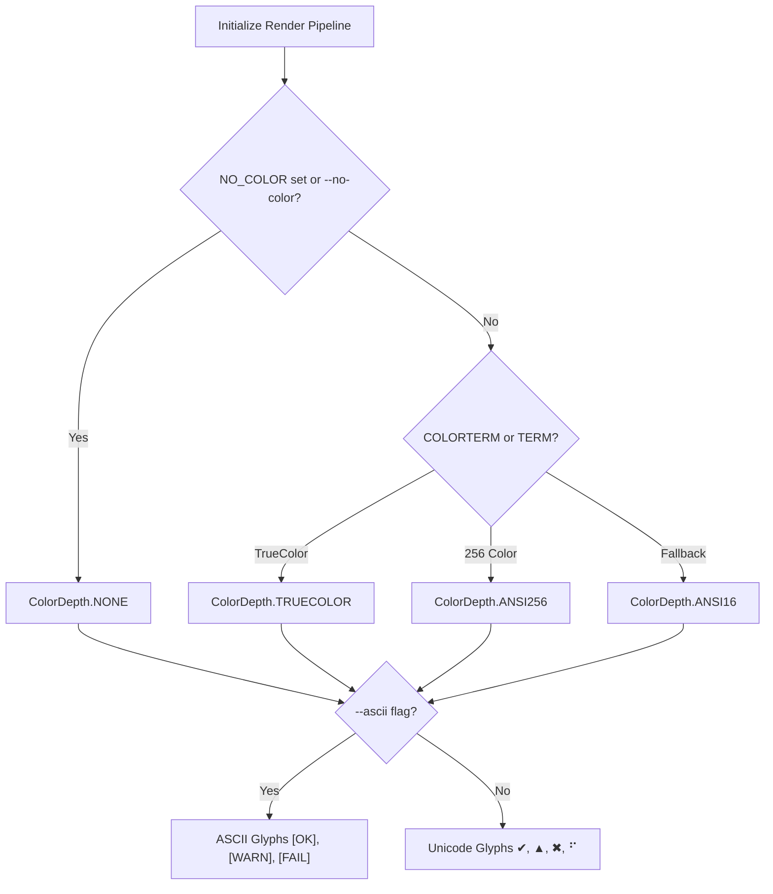

---

## 16. TUI State Machine

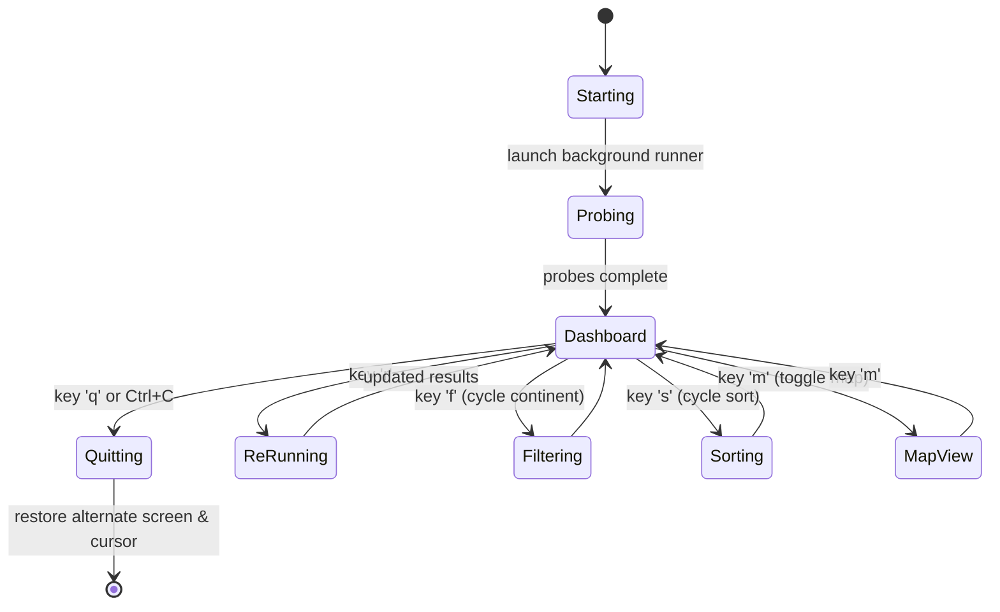

---

## 17. Terminal Map and Landmask Rasterization

The terminal map visualizer uses a rasterized equirectangular land mask derived from Natural Earth (`world-mask.bin`, `< 2 KB` compressed). The binary mask is decoded into a 360×180 boolean grid. When scaling to terminal dimensions:
- Horizontal coordinate $X = \frac{\text{lon} + 180}{360} \times (\text{width} - 1)$
- Vertical coordinate $Y = \frac{90 - \text{lat}}{180} \times (\text{height} - 1)$
- Region targets and the user coordinate (`@`) are rendered directly above land cells.

---

## 18. Security Model

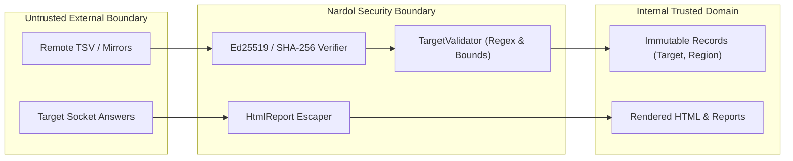

---

## 19. Build, Packaging and CI

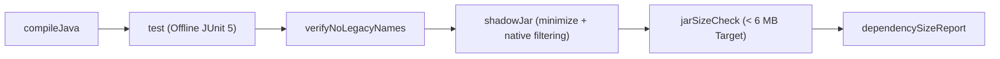

---

## 20. Testing Strategy

| Component | Test Class | Strategy / Technique |
|---|---|---|
| Target Validation & TSV | `ListTest`, `ListExtendedTest` | Boundary assertions, malicious injection strings |
| Cryptography & Signatures | `ListTest` | Ed25519 signing, verification, and tamper detection |
| Math & Distance Formulas | `AnalysisTest` | Haversine coordinates vs known city-pair geodetics |
| Physics Efficiency Floor | `AnalysisTest` | Sub-floor anycast flagging and grade classification |
| Network Socket Probing | `ProbeTest`, `ProbersExtendedTest` | Local loopback server sockets, HTTP and TLS servers |
| Concurrency & Virtual Threads| `ProbeTest` | Fake probers, multi-thread virtual executors |
| Terminal Formatting & Glyphs| `RenderTest` | ANSI suppression under `NO_COLOR`, East-Asian wide text |
| Subcommand Execution | `CliTest` | CommandLine invocation, exit code verification |
| Anti-Regression Token Guard | `LegacyNamesTaskTest` | Planted token detection, allowlist validation |
| Documentation Consistency | `DocsConsistencyTest` | Verifies source classes and mermaid syntax |
| Architecture Imports | `ArchitectureRulesTest` | Bytecode-free static import rules validation |

---

## 21. Extension Guides

### Adding a New Probe Mode
1. Add an entry to `model/ProbeMode.java`.
2. Implement `probe/Prober.java` (e.g. `UdpProber.java`).
3. Wire the prober in `cli/NardolCommand.java` within `runProbes()`.
4. Add unit tests in `src/test/java/com/explodenot/nardol/probe/`.

### Adding a New Color Theme
1. Open `render/Rgb.java` or `render/ReportRenderer.java`.
2. Define the new color palette constants.
3. Map the theme string name in `NardolCommand`'s `--theme` option handler.

---

## 22. Design Decisions
- **Why TCP instead of ICMP?** ICMP sockets on Unix and Windows require root/administrator privileges. TCP connects allow unprivileged execution anywhere.
- **Why Gson over Jackson?** Jackson requires multiple modules (~2.5 MB). Gson provides complete JSON Lines and object binding in a single ~285 KB artifact.
- **Why Virtual Threads?** Probing 60+ distributed servers concurrently with low latency requires high thread counts without OS thread overhead.
- See [DECISIONS.md](DECISIONS.md) for full justifications.

---

## 23. Troubleshooting for Developers
- **JLine Native Provider**: If native libraries fail to extract, Nardol catches the exception and falls back to plain ANSI without terminating.
- **Windows Console**: Legacy `cmd.exe` consoles default to ASCII glyphs when Unicode support is absent.
- **Flaky Tests**: Tests use deterministic local sockets (`127.0.0.1`) with zero external network access.

---

## 24. Glossary
- **Beacon / Target**: A unicast, region-pinned server host.
- **Region Group**: A cluster of targets sharing a `region_id` with 1 primary and fallback servers.
- **Physics Floor**: $2 \times \text{distance} / 200\text{ km/ms}$, the theoretical light speed limit in glass fiber.
- **Likely Anycast**: An endpoint that answers faster than the speed of light allows for the geographic distance.

---

## 25. Conventions
- Immutable records for all data models.
- Sealed interfaces for closed polymorphism (`ProbeOutcome`).
- Zero telemetry, zero external network calls during test execution.

---

## 26. Target List Cryptography, Hosting & Maintenance

### What is the `targets.tsv.sig` file?
`targets.tsv.sig` is an immutable, raw binary 64-byte Ed25519 digital signature of the canonical `targets.tsv` file.
- It proves cryptographic authenticity and content integrity: no third party or proxy can tamper with, redirect, or inject arbitrary target hostnames into the list downloaded by Nardol clients.
- If a downloaded list is modified by even a single byte or character, the Ed25519 signature verification fails immediately.

### How does signature verification work?
1. **Public Key**: The corresponding public key (`targets-public.key`, 44-byte X.509 ASN.1 SubjectPublicKeyInfo) is bundled directly into the application JAR at `/targets-public.key`.
2. **Private Key**: The Ed25519 private key (`tools/keys/ed25519-private.key`) is maintained offline / out-of-band by the project maintainers and is never shipped in distributed binaries.
3. **Verification Flow**:
   - When `RemoteFetcher` downloads `targets.tsv` from a remote URL, it concurrently downloads `${url}.sig` (and falls back to `${url}.sha256` if configured).
   - `SignatureVerifier.verify(byte[] data, byte[] signatureBytes)` invokes Java's native `Signature.getInstance("Ed25519")` with the bundled public key.
   - If verification succeeds, the new target list is saved to local cache (`~/.cache/nardol/targets.tsv`).
   - If verification fails, Nardol rejects the remote payload, prints an integrity warning, and falls back to the previous verified cache or bundled offline list (unless `--insecure-skip-verify` is explicitly supplied).

### What needs to be hosted?
For client auto-updates and on-demand updates (`nardol list update`) to function, host the following files together on an HTTPS web server or CDN (such as `https://explodenot.com/nardol/` or GitHub raw content mirrors):

| File | MIME Type | Purpose |
|---|---|---|
| `targets.tsv` | `text/tab-separated-values` or `text/plain` | The tab-delimited target endpoints |
| `targets.tsv.sig` | `application/octet-stream` | Raw 64-byte Ed25519 binary signature |
| `targets.tsv.sha256` | `text/plain` | Standard SHA-256 checksum file (hex digest + filename) |

HTTP servers hosting these assets should return standard caching headers (`ETag` and `Last-Modified`) to allow Nardol to make lightweight conditional `304 Not Modified` checks during daily runs.

### What should be done after modifying `targets.tsv`?
Whenever any row or field in `targets.tsv` is added, updated, or removed, execute the following steps in order:

```bash
# 1. Lint and validate the target list schema, coordinates, and unicast rules
./nardol list validate targets.tsv

# 2. Sync to resources so the bundled fallback list is kept up to date
cp targets.tsv src/main/resources/targets.tsv

# 3. Re-sign the target list with the Ed25519 signing tool
java tools/SignListTool.java src/main/resources/targets.tsv

# 4. Recompute the SHA-256 checksums
shasum -a 256 src/main/resources/targets.tsv | awk '{print $1 "  targets.tsv"}' > src/main/resources/targets.tsv.sha256
cp src/main/resources/targets.tsv.sha256 targets.tsv.sha256

# 5. Run the test suite to ensure parser and signature assertions pass
./gradlew check

# 6. Upload targets.tsv, targets.tsv.sig, and targets.tsv.sha256 to your hosting server (e.g. explodenot.com/nardol/)
```

---

## 27. CI & Automated List Health Monitoring

Nardol maintains automated GitHub Actions pipelines located in `.github/workflows/`:

```mermaid
flowchart TD
    subgraph CI["ci.yml (Push / PR on main)"]
        Matrix["Matrix: Ubuntu / macOS / Windows x Java 21 / 25"] --> Build["./gradlew build check"]
        Build --> Size["./gradlew dependencySizeReport jarSizeCheck"]
        Size --> Upload["Upload nardol-*-all.jar Artifact"]
    end
    subgraph Health["list-health.yml (Daily 04:00 UTC)"]
        DailyCron["Cron: 0 4 * * *"] --> BuildProber["./gradlew shadowJar"]
        BuildProber --> RunHealthCheck["Probe all 64 regions (--json --timeout 5000)"]
        RunHealthCheck --> JqReport["Parse unreachable / degraded count"]
    end
    subgraph Rel["release.yml (Tag v*)"]
        TagPush["Push tag v*"] --> BuildRel["./gradlew build check shadowJar"]
        BuildRel --> Checksum["Compute sha256sum"]
        Checksum --> GHRelease["softprops/action-gh-release"]
    end
```

### Daily List Health Check (`list-health.yml`)
- **Trigger**: Runs every morning at **04:00 UTC** (`0 4 * * *`) and on manual `workflow_dispatch`.
- **Function**: Builds the fat jar and executes `java -jar nardol-all.jar --json --timeout 5000 --samples 2`.
- **Purpose**: Detects defunct cloud endpoints, decommissioned university servers, IP blocks, or persistent routing degradations across the global candidate pool before end users experience probe failures.
- **Action on Failure**: If any endpoint is permanently decommissioned, maintainers can swap the endpoint in `targets.tsv` and re-sign it. Clients will automatically receive the updated list on their next daily check.

---

## 28. Release Instructions & Commands

Follow this checklist to prepare and publish a new official NARDOL release:

### 1. Pre-Release Verification
Ensure all static analysis, unit tests, and size budgets pass cleanly:
```bash
# Verify semgrep SAST rules (must be 0 findings)
semgrep scan --config auto

# Clean build, test, and budget check
./gradlew clean check shadowJar

# Verify binary execution and version output
./nardol --version
./nardol doctor
```

### 2. Update Documentation and Versioning
1. Bump version in `build.gradle.kts` (`version = "X.Y.Z"`).
2. Bump version in `src/main/resources/version.properties` (`version=X.Y.Z`).
3. Add release summary in `CHANGELOG.md` following [Keep a Changelog](https://keepachangelog.com/).
4. Update fat jar filenames in `README.md` (`nardol-X.Y.Z-all.jar`).
5. Update test assertions in `src/test/java/com/explodenot/nardol/cli/CliTest.java` and `LegacyNamesTaskTest.java`.

### 3. Commit and Tag
```bash
git add -A
git commit -m "chore: release vX.Y.Z"
git tag -a vX.Y.Z -m "Release vX.Y.Z"
git push origin main
git push origin vX.Y.Z
```

### 4. Automated Release Pipeline
Pushing the `v*` tag triggers [.github/workflows/release.yml](.github/workflows/release.yml), which:
1. Builds `nardol-X.Y.Z-all.jar`.
2. Generates `nardol-sha256.txt` with SHA-256 checksums.
3. Automatically publishes the GitHub Release with the jar and checksums attached.
